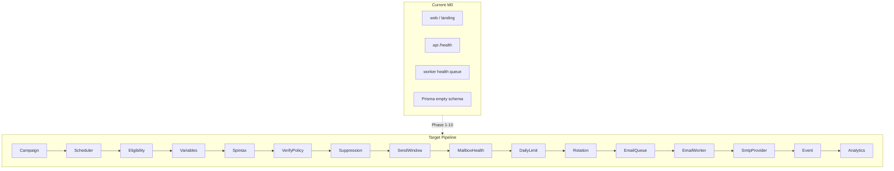

# Feature Integration Audit

**Phase:** 0 — Audit only (no product implementation)  
**Date:** August 2026  
**Scope:** Nine product features for SignalForge outbound sales platform  
**Status:** SignalForge is at **M0.01** — production foundation with no product features implemented in code

**Related docs:** [Architecture](architecture.md) · [Database](database.md) · [Email Infrastructure](email-infrastructure.md) · [Sending Engine](sending-engine.md) · [Queue System](queue-system.md) · [Security](security.md) · [UI Audit](ui-audit.md) · [Product PRD](product/AI_Outbound_Sales_OS_PRD_v1.1.pdf)

---

## Executive Summary

SignalForge is a well-structured pnpm + Turborepo monorepo with real infrastructure (Fastify API, Next.js web, PostgreSQL, Redis/BullMQ, email worker heartbeat) but **zero product data models and zero product APIs**. All nine requested features are **documented or stubbed** but **not implemented**.

| Feature | Status |
|---------|--------|
| 1. Multiple SMTP Integrations | Stub only |
| 2. SMTP Rotation | Docs only |
| 3. Dynamic Variables | Not implemented |
| 4. Unlimited Campaigns | Not implemented (no campaigns exist) |
| 5. Country Filters | Not implemented |
| 6. Smart Email Verification | Not implemented |
| 7. Blacklist / Suppression | Planned in docs |
| 8. Pause / Resume | Not implemented |
| 9. Spintax Support | Not implemented |

**Critical blocker for Phase 1:** Multi-tenant auth and workspace isolation (M1) is stub-only. Mailboxes cannot be securely workspace-scoped without it.

**Phase 0 deliverable:** This document. **Do not begin implementation until explicitly instructed with `START PHASE 1`.**

---

## 1. Existing Implementation

### 1.1 Repository Structure

```
SignalForge/
├── apps/
│   ├── web/          Next.js 15 frontend (UI only)
│   └── api/          Fastify 5 HTTP API
├── workers/
│   └── email-worker/ BullMQ worker (health heartbeat only)
├── packages/
│   ├── ai/           Mock AI provider (not wired to API/workers)
│   ├── auth/         Stub
│   ├── config/       Zod env validation
│   ├── database/     Prisma 7 + PostgreSQL (empty schema)
│   ├── email/        Stub
│   ├── queue/        BullMQ + Redis helpers
│   ├── shared/       Branded IDs, Result type, JobLogContext
│   ├── validation/   Health response Zod schemas
│   ├── eslint-config/
│   └── typescript-config/
├── docs/             Architecture, ADRs, product docs
└── infrastructure/   Docker, nginx, deployment placeholders
```

**Tech stack:** Node 22, pnpm 9, Turborepo, TypeScript 5.8, Next.js 15, Fastify 5, Prisma 7, PostgreSQL 16, Redis 7, BullMQ 5, Zod, Vitest, shadcn/ui (partial).

### 1.2 Database Schema

**File:** `packages/database/prisma/schema.prisma`

```prisma
generator client {
  provider = "prisma-client"
  output   = "../src/generated/prisma"
}

datasource db {
  provider = "postgresql"
}

// M0: minimal schema — product models added in M1+
```

- **Models:** 0
- **Enums:** 0
- **Indexes / unique constraints:** 0
- **Migration:** `20250822120000_init` — `CREATE SCHEMA IF NOT EXISTS "public"` only

**Planned entities** (documented in `docs/database.md`, not in schema):

- User, Workspace, WorkspaceMember, Role
- Domain, Mailbox, MailboxCredential
- Company, Contact, Lead, LeadList, LeadTag
- ICP, LeadScore, LeadResearch
- Campaign, CampaignStep, CampaignLead
- Email, EmailThread, EmailEvent
- Suppression, Unsubscribe, Bounce
- WarmupProfile, WarmupEvent, MailboxHealth, DomainHealth
- SendingPolicy, RateLimit
- AIJob, AIUsage, Notification, AuditLog, OAuthAccount, Integration

### 1.3 Authentication & Workspace

**File:** `packages/auth/src/index.ts`

```typescript
export const AUTH_PACKAGE_STATUS = 'stub' as const;

export interface AuthSession {
  userId: string;
  workspaceId?: string;
}
```

- No session store, cookies, JWT, OAuth, or middleware
- No workspace CRUD or membership
- No RBAC or permissions
- `SESSION_SECRET` validated in env but **not used in runtime code**
- Multi-tenant model documented in `docs/architecture.md` but not enforced

### 1.4 Lead System

- **No Lead model, API, or UI**
- Branded type only: `LeadId` in `packages/shared/src/index.ts`
- Queue names defined but not wired: `lead-processing`, `lead-enrichment`
- Mock ICP scoring in `@signalforge/ai` (`scoreLead`) — library-only, not exposed via HTTP
- No country, region, state, city, or custom field support
- Lead discovery planned for M11

### 1.5 Campaign System

- **No Campaign model, API, scheduler, or UI**
- Branded type only: `CampaignId`
- Queue name defined: `email-send` — not consumed by worker
- No sequence steps, campaign leads, or statuses
- No campaign count limit exists (because no campaigns exist)

### 1.6 Email / Mailbox System

**File:** `packages/email/src/index.ts`

```typescript
export const EMAIL_PACKAGE_STATUS = 'stub' as const;

export type MailboxProvider = 'smtp' | 'google_oauth' | 'microsoft_oauth';

export interface EmailProvider {
  send(input: { to: string; subject: string; body: string }): Promise<{ messageId: string }>;
}
```

- No SMTP client (nodemailer not installed)
- No credential encryption implementation (`ENCRYPTION_KEY` in env, unused)
- No mailbox CRUD, health tracking, daily limits, or warmup
- Mailpit available in Docker Compose (optional profile) — nothing connects to it
- Planned pipeline documented in `docs/email-infrastructure.md`

### 1.7 Queue System

**File:** `packages/queue/src/index.ts`

| Queue | Purpose | Wired? |
|-------|---------|--------|
| `email-send` | Outbound campaign email | No |
| `email-retry` | Retry transient failures | No |
| `email-inbound` | Inbound IMAP processing | No |
| `warmup` | Warmup scheduling | No |
| `lead-processing` | Import/normalize/dedupe | No |
| `lead-enrichment` | Enrichment jobs | No |
| `ai` | AI scoring/research | No |
| `analytics` | Metric aggregation | No |
| `notifications` | User/system notifications | No |
| `health` | Worker heartbeat | **Yes** |

**BullMQ helpers:** `createQueue`, `createWorker`, `DEFAULT_JOB_OPTIONS` (3 retries, exponential backoff, concurrency 5).

### 1.8 Workers

**File:** `workers/email-worker/src/index.ts`

- Processes **only** `health` queue heartbeat jobs
- Does **not** import `@signalforge/email`
- Structured JSON logging via `JobLogContext` pattern
- No email sending, suppression checks, or policy evaluation

### 1.9 Sending Policy Engine

**Documented in:** `docs/sending-engine.md`

Planned checks before every send:

- Campaign and lead active status
- Suppression and unsubscribe state
- Previous bounces
- Mailbox and domain health
- Warmup restrictions
- Daily mailbox, campaign, and provider limits
- Sending windows and rate limits
- Workspace policy and compliance rules

**Implementation status:** Documentation only. No `SendingPolicyEngine` class exists.

### 1.10 API

**Pattern:** Fastify REST plugins (no tRPC, no Next.js API routes)

| Method | Path | Status |
|--------|------|--------|
| GET | `/` | Real — service metadata |
| GET | `/health` | Real — API liveness |
| GET | `/health/db` | Real — Postgres check |
| GET | `/health/redis` | Real — Redis check |

**Middleware:** Helmet, CORS (restricted to `APP_URL`). No auth middleware.

**Validation:** Zod on health response payloads only (`packages/validation`).

### 1.11 UI

**Routes:** 1 page — `/` (M0 landing + health card)

**Components:** Button, Card (shadcn partial install), HealthStatus, Providers

**Design:** Light theme. Target dark navy + royal blue documented in `docs/ui-audit.md` but not implemented.

**Missing:** App shell, auth, dashboard, leads, campaigns, mailboxes, inbox, settings, suppression UI.

**Live integration:** `fetchHealth()` → `GET /health` only.

### 1.12 Validation & Tests

| Package | Tests |
|---------|-------|
| `apps/api` | Health route (Vitest) |
| `packages/config` | Env schema validation |
| `packages/shared` | Result helpers |
| `packages/ai` | Mock provider determinism |
| Others | `--passWithNoTests` |

No integration tests for DB/Redis, no e2e tests, no product feature tests.

### 1.13 Security Foundations

- Env validation with required `ENCRYPTION_KEY` and `SESSION_SECRET` (min 32 chars)
- Helmet + CORS on API
- Policy documented: never log credentials, encrypt at rest (M3+)
- **No encryption/decryption implementation**
- **No authorization middleware**
- **No audit log**

### 1.14 Type-Level Groundwork (Reusable)

**File:** `packages/shared/src/index.ts`

```typescript
export type WorkspaceId = Brand<string, 'WorkspaceId'>;
export type UserId = Brand<string, 'UserId'>;
export type CampaignId = Brand<string, 'CampaignId'>;
export type MailboxId = Brand<string, 'MailboxId'>;
export type LeadId = Brand<string, 'LeadId'>;

export interface JobLogContext {
  jobId?: string;
  workspaceId?: string;
  campaignId?: string;
  mailboxId?: string;
  leadId?: string;
  status?: string;
  durationMs?: number;
  error?: string;
  retryCount?: number;
}
```

**Note:** `campaignLeadId` is missing from `JobLogContext` — should be added during pipeline implementation.

### 1.15 AI Package (Partial)

**File:** `packages/ai/src/types.ts`

- `AIProvider` interface with methods: `scoreLead`, `personalizeEmail`, `generateEmail`, `classifyReply`, `analyzeDeliverability`
- Mock provider returns deterministic results
- Reply classification includes `UNSUBSCRIBE` category (not a suppression system)
- **Not wired** to any queue, API, or sending flow

---

## 2. Missing Functionality (By Feature)

### Feature 1 — Multiple SMTP Integrations

| Requirement | Status |
|-------------|--------|
| Multiple mailboxes per workspace | Missing |
| Provider, email, from name, host, port, username | Missing |
| Encrypted SMTP password | Missing (no encryption service) |
| Encryption/security type | Missing |
| Status, daily limit, current usage | Missing |
| Health status, warmup status | Missing |
| Last successful send, last error | Missing |
| Assigned campaigns | Missing |
| Credential never returned to frontend | N/A (no credentials stored) |
| Secure mailbox credential service | Missing |
| Provider abstraction (not hardcoded) | Partial — `MailboxProvider` union only |
| SMTP test endpoint | Missing |

### Feature 2 — SMTP Rotation

| Requirement | Status |
|-------------|--------|
| Central Sending Policy Engine | Docs only |
| SMTP Rotation Engine | Missing |
| Consider mailbox status, limits, usage, health | Missing |
| Consider warmup, domain health, campaign assignment | Missing |
| Consider sending window, provider restrictions, rate limits | Missing |
| Exclude unhealthy mailboxes | Missing |
| Rotation strategies (round robin, least utilized, health-aware, campaign-specific) | Missing |
| Default health-aware strategy | Missing |

### Feature 3 — Dynamic Variables

| Requirement | Status |
|-------------|--------|
| VariableResolver service | Missing |
| Standard variables (`{{first_name}}`, `{{company}}`, etc.) | Missing |
| Custom fields (`{{custom.*}}`) | Missing |
| Future AI variables (`{{ai_*}}`) | Missing |
| Detect, validate, resolve variables | Missing |
| Detect missing values with fallback | Missing |
| Block sends with unresolved variables | Missing |
| Pre-launch template validation | Missing |
| Review leads with missing variables | Missing |

### Feature 4 — Unlimited Campaigns

| Requirement | Status |
|-------------|--------|
| No hardcoded campaign count limit | N/A (no limit exists) |
| Infrastructure protection (queue, rate, concurrency, indexing) | Partial — BullMQ concurrency=5 only |
| Campaign model scaling | Missing |
| Search, filters, sorting, pagination | Missing |
| Status filtering (DRAFT, ACTIVE, PAUSED, COMPLETED, ARCHIVED) | Missing |

### Feature 5 — Country Filters

| Requirement | Status |
|-------------|--------|
| Normalized geographic fields on Lead | Missing |
| Country code (ISO) preference | Missing |
| Region, state/province, city | Missing |
| Database-level filtering | Missing |
| Appropriate indexes | Missing |
| Lead discovery geo filters | Missing |
| UI filters (country → state → city) | Missing |

### Feature 6 — Smart Email Verification

| Requirement | Status |
|-------------|--------|
| EmailVerificationService | Missing |
| Pipeline: syntax → domain → MX → disposable → role → risk | Missing |
| Statuses: VERIFIED, RISKY, INVALID, UNKNOWN, DISPOSABLE, ROLE_BASED | Missing |
| Store status, score, timestamp, reason, domain, MX status | Missing |
| Provider-agnostic design | Missing |
| Confidence/risk (not absolute certainty) | Missing |
| Workspace policy to exclude INVALID/DISPOSABLE/HIGH-RISK | Missing |

### Feature 7 — Blacklist / Suppression

| Requirement | Status |
|-------------|--------|
| Centralized Suppression & Blacklist module | Missing |
| Global workspace suppression | Missing |
| Email and domain suppression | Missing |
| Reasons: MANUAL, UNSUBSCRIBED, BOUNCED, SPAM_COMPLAINT, INVALID, RISKY | Missing |
| Pre-send suppression check (BLOCK_SEND) | Missing |
| Store suppression reason | Missing |
| Never send to suppressed recipients | Missing |
| Settings UI | Missing |

### Feature 8 — Pause / Resume

| Requirement | Status |
|-------------|--------|
| Campaign-level pause/resume | Missing |
| Sequence-level pause/resume | Missing |
| Lead-level pause/resume | Missing |
| Mailbox-level pause/resume | Missing |
| Stop new scheduling when paused | Missing |
| Prevent queued jobs from executing when paused | Missing |
| Preserve progress, lead state, analytics | Missing |
| Recalculate eligible leads on resume | Missing |
| Re-check all policies before executing queued jobs | Missing |

### Feature 9 — Spintax Support

| Requirement | Status |
|-------------|--------|
| SpintaxParser service | Missing |
| Nested/valid syntax handling | Missing |
| Malformed syntax detection | Missing |
| One variation per send | Missing |
| Deterministic output in tests | Missing |
| Random variations in production | Missing |
| Never modify stored campaign template | Missing |
| Store final rendered email for audit | Missing |

---

## 3. Required Database Changes

**Principle:** Introduce models incrementally per phase. Reuse planned entity names from `docs/database.md`. Do not duplicate.

### 3.1 Prerequisite (Before Phase 1)

Required for multi-tenant mailbox security:

```
User
Workspace
WorkspaceMember
Role (or enum on WorkspaceMember)
AuditLog (optional but recommended early)
```

### 3.2 Phase 1 — Multiple SMTP Integrations

```
Mailbox
  - id, workspaceId, provider, emailAddress, fromName
  - smtpHost, smtpPort, smtpUsername, encryptionType
  - status (ACTIVE, PAUSED, ERROR, etc.)
  - dailySendingLimit, currentDailyUsage (or separate usage table)
  - healthStatus, warmupStatus
  - lastSuccessfulSendAt, lastErrorAt, lastErrorMessage
  - createdAt, updatedAt

MailboxCredential
  - id, mailboxId
  - encryptedPayload (AES-256-GCM blob, never plaintext)
  - keyVersion (for rotation)
  - createdAt, updatedAt

CampaignMailbox (many-to-many, or JSON on Campaign — prefer join table)
  - campaignId, mailboxId
```

**Indexes:**

- `@@index([workspaceId, status])` on Mailbox
- `@@unique([workspaceId, emailAddress])` on Mailbox

### 3.3 Phase 2 — Mailbox Health + SMTP Rotation

```
MailboxHealth (or fields on Mailbox)
  - mailboxId, score, lastCheckedAt, failureCount, consecutiveFailures

DomainHealth (optional, if domain-level tracking needed)
  - domain, workspaceId, score, lastCheckedAt

SendingPolicy
  - workspaceId, campaignId (nullable)
  - rotationStrategy (ROUND_ROBIN, LEAST_UTILIZED, HEALTH_AWARE, CAMPAIGN_SPECIFIC)
  - defaultStrategy = HEALTH_AWARE
```

### 3.4 Phase 3 — Suppression / Blacklist

```
Suppression
  - id, workspaceId
  - type (EMAIL, DOMAIN)
  - value (email address or domain)
  - reason (MANUAL, UNSUBSCRIBED, BOUNCED, SPAM_COMPLAINT, INVALID, RISKY)
  - source (USER, SYSTEM, WEBHOOK, etc.)
  - createdAt

@@unique([workspaceId, type, value])
@@index([workspaceId, type, value])
```

### 3.5 Phase 4 — Smart Email Verification

```
LeadVerification (or fields on Lead/Contact)
  - id, leadId (or contactId)
  - email
  - status (VERIFIED, RISKY, INVALID, UNKNOWN, DISPOSABLE, ROLE_BASED)
  - score (0-100 confidence)
  - reason, domain, mxStatus
  - verifiedAt
  - createdAt, updatedAt

@@index([workspaceId, status]) via Lead relation
```

Add workspace-level verification policy (fields on Workspace or SendingPolicy):

- `excludeInvalid`, `excludeDisposable`, `excludeHighRisk`

### 3.6 Phase 5 — Dynamic Variables

```
CustomField
  - id, workspaceId
  - entityType (LEAD, COMPANY, etc.)
  - key, label, fieldType
  - createdAt

LeadCustomFieldValue (or JSON on Lead for M2 simplicity)
  - leadId, customFieldId, value
```

No separate Variable table needed — variables are template syntax resolved at runtime.

### 3.7 Phase 6 — Spintax

No new models. Spintax is parsed at send time.

Ensure `EmailMessage` (or equivalent) stores:

- `renderedSubject`, `renderedBody` (final output)
- `templateSubject`, `templateBody` (original, unchanged)

### 3.8 Phase 7 — Pause / Resume

Add status fields:

```
Campaign.status: DRAFT | ACTIVE | PAUSED | COMPLETED | ARCHIVED
CampaignLead.status: include PAUSED
Mailbox.status: include PAUSED (already in Phase 1)
```

Optional: `pausedAt`, `pausedBy`, `pauseReason` on Campaign, CampaignLead, Mailbox.

### 3.9 Phase 8 — Country Filters

Add to Lead (or Contact):

```
countryCode   String?   // ISO 3166-1 alpha-2, e.g. "US"
country         String?   // Display name, e.g. "United States"
region          String?
state           String?
city            String?
```

**Indexes:**

- `@@index([workspaceId, countryCode])`
- `@@index([workspaceId, countryCode, state])`
- `@@index([workspaceId, countryCode, state, city])`

### 3.10 Phase 9 — Unlimited Campaigns

```
Campaign
  - id, workspaceId, name, status
  - rotationStrategy, sendingPolicyId
  - scheduleConfig (JSON)
  - verificationPolicy, suppressionPolicy
  - createdAt, updatedAt, archivedAt

CampaignStep
  - id, campaignId, order, delayDays
  - subjectTemplate, bodyTemplate
  - createdAt

CampaignLead
  - id, campaignId, leadId
  - currentStepOrder, status
  - enrolledAt, completedAt, pausedAt

@@index([workspaceId, status, createdAt])  // list + filter + sort
@@index([campaignId, status])
@@unique([campaignId, leadId])
```

No `campaignCount` constraint. Use infrastructure limits instead.

### 3.11 Phase 10 — Central Pipeline

```
EmailMessage (or Email)
  - id, workspaceId, campaignId, campaignLeadId, leadId, mailboxId
  - jobId (BullMQ)
  - templateSubject, templateBody
  - renderedSubject, renderedBody
  - status (QUEUED, SENT, BLOCKED, FAILED, BOUNCED)
  - blockReason (if blocked)
  - sentAt, messageId (provider)
  - createdAt

EmailEvent (for analytics/observability)
  - emailMessageId, eventType, metadata, createdAt
```

---

## 4. Required API Changes

**Convention:** Fastify plugins registered in `apps/api/src/app.ts` with prefixes. Zod schemas in `@signalforge/validation`. Auth middleware on all protected routes.

### 4.1 Prerequisite — Auth Middleware

```
POST /auth/login
POST /auth/logout
GET  /auth/session
POST /workspaces
GET  /workspaces
GET  /workspaces/:id
```

All subsequent routes require:

```
Authenticated user → Workspace membership → Permission → Resource ownership
```

### 4.2 Phase 1 — Mailbox API

| Method | Path | Description |
|--------|------|-------------|
| POST | `/mailboxes` | Create mailbox (credentials encrypted server-side) |
| GET | `/mailboxes` | List workspace mailboxes (no credentials) |
| GET | `/mailboxes/:id` | Get mailbox detail (no credentials) |
| PATCH | `/mailboxes/:id` | Update mailbox (re-encrypt credentials if changed) |
| DELETE | `/mailboxes/:id` | Remove mailbox |
| POST | `/mailboxes/:id/test` | Test SMTP connection |
| POST | `/mailboxes/:id/pause` | Pause mailbox |
| POST | `/mailboxes/:id/resume` | Resume mailbox |

**Response rules:**

- Never include `password`, `encryptedPayload`, or OAuth tokens
- Include: email, provider, status, dailyLimit, sentToday, health, warmup, assignedCampaigns

### 4.3 Phase 2 — Rotation (Internal + Campaign Config)

Rotation is primarily internal to Sending Policy Engine. Expose via:

- `PATCH /campaigns/:id` — set `rotationStrategy`
- `GET /mailboxes/:id/health` — optional health detail endpoint

### 4.4 Phase 3 — Suppression API

| Method | Path | Description |
|--------|------|-------------|
| GET | `/suppressions` | List with filters (type, reason, date) |
| POST | `/suppressions` | Add email or domain suppression |
| DELETE | `/suppressions/:id` | Remove suppression |
| POST | `/suppressions/bulk` | Bulk import |

### 4.5 Phase 4 — Verification API

| Method | Path | Description |
|--------|------|-------------|
| POST | `/verification/check` | Verify single email |
| POST | `/verification/bulk` | Verify multiple emails |

### 4.6 Phase 5–6 — Variables & Spintax (Campaign API)

| Method | Path | Description |
|--------|------|-------------|
| POST | `/campaigns/:id/validate-template` | Validate variables + spintax |
| GET | `/campaigns/:id/preview` | Preview rendered email for lead |
| GET | `/custom-fields` | List workspace custom fields |
| POST | `/custom-fields` | Create custom field |

### 4.7 Phase 7 — Pause / Resume

| Method | Path | Description |
|--------|------|-------------|
| POST | `/campaigns/:id/pause` | Pause campaign |
| POST | `/campaigns/:id/resume` | Resume campaign |
| POST | `/campaigns/:id/leads/:leadId/pause` | Pause lead in campaign |
| POST | `/campaigns/:id/leads/:leadId/resume` | Resume lead in campaign |

(Mailbox pause/resume already in Phase 1.)

### 4.8 Phase 8 — Lead Filters

| Method | Path | Description |
|--------|------|-------------|
| GET | `/leads` | Query params: `countryCode`, `state`, `city`, `verificationStatus`, etc. |

### 4.9 Phase 9 — Campaign List

| Method | Path | Description |
|--------|------|-------------|
| POST | `/campaigns` | Create campaign |
| GET | `/campaigns` | List with search, filter, sort, pagination |
| GET | `/campaigns/:id` | Get campaign detail |
| PATCH | `/campaigns/:id` | Update campaign |
| DELETE | `/campaigns/:id` | Delete/archive campaign |
| POST | `/campaigns/:id/activate` | Activate with readiness checks |

**Query params for GET /campaigns:**

- `search`, `status`, `sortBy`, `sortOrder`, `page`, `limit`

---

## 5. Required Worker Changes

### 5.1 Current State

- `workers/email-worker` processes `health` queue only
- Concurrency: 5 (global, hardcoded in `packages/queue/src/bullmq.ts`)
- Structured logging pattern exists but minimal context

### 5.2 Required Changes (Phased)

**Phase 1–2:** Add `email-send` and `email-retry` queue processors.

**Job payload (proposed):**

```typescript
interface EmailSendJobData {
  workspaceId: string;
  campaignId: string;
  campaignLeadId: string;
  leadId: string;
  stepId: string;
  mailboxId?: string; // optional pre-selection; rotation may override
  jobId: string;
}
```

**Phase 3+:** Worker must execute full pipeline before send:

```
1. Load campaign, lead, step
2. Check campaign/lead/mailbox pause status → BLOCK if paused
3. Resolve variables → BLOCK if unresolved
4. Parse spintax → BLOCK if malformed/unresolved
5. Check verification policy → BLOCK if excluded
6. Check suppression → BLOCK if suppressed
7. Check sending window → DEFER if outside window
8. Check mailbox health → exclude unhealthy
9. Check daily limits → BLOCK or DEFER
10. SMTP rotation → select mailbox
11. Send via SMTP provider
12. Store EmailMessage with rendered content
13. Emit event for analytics
```

**On resume:** Queued jobs must re-run steps 2–10. Do not blindly send.

**Logging:** Extend `JobLogContext`:

```typescript
export interface JobLogContext {
  jobId?: string;
  workspaceId?: string;
  campaignId?: string;
  campaignLeadId?: string;  // ADD
  leadId?: string;
  mailboxId?: string;
  status?: string;
  blockReason?: string;    // ADD
  rotationStrategy?: string; // ADD
  durationMs?: number;
  error?: string;
  retryCount?: number;
}
```

**Never log:** passwords, tokens, encryption keys, full email credentials.

### 5.3 Concurrency & Resource Controls

- Make worker concurrency configurable via env
- Per-workspace rate limits (Redis counters)
- Per-mailbox daily limits (DB + Redis)
- Queue job limits per workspace (not campaign count limits)

---

## 6. Required UI Changes

**Preserve:** App Router, TanStack Query, `fetchHealth()`, `cn()`, shadcn conventions.

**Design system:** Dark navy foundation (`#09090B`), royal blue accent (`#2563EB`), white/neutral gray text. See `docs/ui-audit.md`.

### 6.1 App Shell (Prerequisite)

- Sidebar navigation
- Header with workspace switcher, user menu
- Route groups: `(auth)`, `(app)`
- Auth middleware for protected routes

### 6.2 Mailbox UI (Phase 1)

**Route:** `/mailboxes`

- "Connect Mailbox" button → dialog/wizard
- Mailbox cards or table showing:
  - Email, Provider, Status, Daily limit, Sent today, Health, Warmup, Campaigns
- Actions: Test, Pause, Resume, Edit, Remove
- Edit form: all fields except password (password field for update only, never displayed)

### 6.3 Campaign UI (Phase 9, partial earlier)

**Routes:** `/campaigns`, `/campaigns/new`, `/campaigns/:id`

- Campaign list: search, filters, sort, pagination, status badges
- Campaign creation wizard:
  - Name, Lead list, Mailboxes, Rotation strategy
  - Sending limits, Schedule, Sequence
  - Variables, Spintax, Verification policy, Suppression policy
- Campaign Readiness checklist before activation:
  - ✓ Mailboxes connected
  - ✓ Leads available
  - ✓ Variables valid
  - ✓ Emails verified
  - ✓ Suppression checked
  - ✓ Sending limits configured

### 6.4 Email Editor UI (Phase 5–6)

- Variable picker: "+ Insert Variable" dropdown
  - First Name, Last Name, Company, Job Title, Industry, Country, City, Custom Field
- Spintax helper with syntax hint: `{Hi|Hello|Hey}`
- Preview panel:
  - "Rendered Email" view
  - "Preview Lead 1 / 2 / 3" selector

### 6.5 Lead UI (Phase 8)

**Route:** `/leads`

- Filters: Country, State, City, Verification status, ICP score, Campaign, Suppression status
- Table columns: Name, Company, Email, Country, Job Title, Verification, ICP Score, Campaign, Status

### 6.6 Suppression UI (Phase 3)

**Route:** `/settings/suppression`

- Table: Email/Domain, Type, Reason, Date, Source
- Actions: Add email, Add domain, Remove, Bulk import

### 6.7 shadcn Components Needed

Install before feature UI:

- Table, Dialog, Input, Select, Badge, Tabs, Toast, Skeleton, Alert
- Dropdown Menu, Pagination, Separator, Tooltip
- Sidebar (for app shell)

---

## 7. Dependencies

### 7.1 Hard Blockers

| Dependency | Blocks | Notes |
|------------|--------|-------|
| Auth + Workspace (M1) | Phase 1 (Mailboxes) | Mailboxes must be workspace-scoped |
| Lead model (M2) | Phase 5, 8 | Variables and country filters need leads |
| Campaign model (M4) | Phase 7, 9 | Pause/resume and campaign list need campaigns |
| Encryption service | Phase 1 | `ENCRYPTION_KEY` exists but no implementation |

### 7.2 External Dependencies (To Add)

| Package | Purpose | Phase |
|---------|---------|-------|
| `nodemailer` (or similar) | SMTP transport | Phase 1 |
| `dns` (Node built-in) | MX lookup | Phase 4 |
| Disposable domain list | Email verification | Phase 4 |

### 7.3 Internal Package Dependencies

```
Phase 1:  auth → database → email (new encryption, SMTP adapter)
Phase 2:  email → sending-policy (new package or module)
Phase 3:  suppression (new module) → used by sending-policy
Phase 4:  verification (new module) → used by sending-policy
Phase 5:  variables (new module) → used by campaign API + worker
Phase 6:  spintax (new module) → used by variables + worker
Phase 7:  pause/resume logic → campaign service + worker
Phase 8:  lead filters → lead API + database indexes
Phase 9:  campaign list → campaign API + UI
Phase 10: pipeline orchestrator → ties all modules in worker
```

### 7.4 Infrastructure Dependencies

- PostgreSQL 16 (running via Docker Compose)
- Redis 7 (running via Docker Compose)
- Mailpit (optional, for local SMTP testing)

---

## 8. Risks

### 8.1 High Priority

| Risk | Impact | Mitigation |
|------|--------|------------|
| Implementing SMTP before auth/workspace | Non-isolated, insecure mailboxes | Insert thin M1 prerequisite before Phase 1 |
| Single giant schema migration | Hard to review, risky rollback | Introduce models incrementally per phase |
| Resume blindly flushing queued jobs | Sends to suppressed/paused/unhealthy recipients | Re-run full policy pipeline on every job execution |
| Exposing credentials to frontend | Security breach | Never return encrypted blob; encrypt server-side only |
| Implementing all 9 features in one PR | Unreviewable, untestable | Strict phase-by-phase delivery |

### 8.2 Medium Priority

| Risk | Impact | Mitigation |
|------|--------|------------|
| Global worker concurrency=5 | Bottleneck at scale | Make configurable; add per-workspace limits |
| Light theme vs dark premium UI | Inconsistent brand | Migrate tokens in app shell phase, not per-feature |
| No campaign count limit | Resource exhaustion | Use queue limits, rate limits, indexing — not count caps |
| Fake SMTP probe certainty | False deliverability claims | Represent verification as confidence/risk scores |
| Missing `campaignLeadId` in logs | Poor observability | Add to JobLogContext in Phase 10 |

### 8.3 Low Priority

| Risk | Impact | Mitigation |
|------|--------|------------|
| Mailpit not connected | Manual SMTP testing harder | Wire test endpoint to Mailpit in dev |
| AI variables before AI integration | Unused complexity | Design VariableResolver extensibility; implement AI vars in M9 |
| Duplicate suppression on bounce + manual | Data redundancy | Use unique constraint on workspace+type+value |

---

## 9. Recommended Implementation Order

### Phase 0 — Audit (This Document)

- [x] Inspect codebase
- [x] Document existing vs missing
- [x] Define database, API, worker, UI changes
- [x] Identify dependencies and risks
- [x] Recommend sequence

**STOP HERE. Wait for `START PHASE 1`.**

---

### Prerequisite — Thin M1 (Auth & Workspace)

**Must complete before Phase 1.**

1. Add User, Workspace, WorkspaceMember models
2. Implement session auth (cookie-based or JWT)
3. Add auth middleware to Fastify
4. Enforce workspace isolation on all queries
5. Basic login/signup UI (minimal)

**Files:**

- `packages/database/prisma/schema.prisma`
- `packages/auth/src/*`
- `apps/api/src/plugins/auth.ts`
- `apps/api/src/routes/auth.ts`
- `apps/web/src/app/(auth)/*`

---

### Phase 1 — Multiple SMTP Integrations

1. Implement credential encryption service (`ENCRYPTION_KEY`)
2. Add Mailbox, MailboxCredential models
3. Implement SMTP provider adapter (nodemailer behind EmailProvider)
4. Mailbox CRUD API (no credential exposure)
5. Test connection endpoint
6. Mailbox UI (Connect, list, edit, remove)
7. Tests: encryption, CRUD, workspace isolation, credential non-exposure

---

### Phase 2 — Mailbox Health + SMTP Rotation

1. Add MailboxHealth, SendingPolicy models
2. Implement health tracking (success/failure counts)
3. Implement SMTP Rotation Engine with strategies
4. Default: health-aware rotation
5. Integrate rotation into policy engine (internal)
6. Tests: rotation strategies, unhealthy exclusion, daily limits

---

### Phase 3 — Suppression / Blacklist

1. Add Suppression model
2. Implement SuppressionEngine
3. Suppression API (CRUD, bulk import)
4. Integrate pre-send check in worker
5. Suppression UI (Settings → Suppression)
6. Tests: email/domain suppression, unsubscribe, bounce auto-add

---

### Phase 4 — Smart Email Verification

1. Add LeadVerification model (or fields on Lead)
2. Implement EmailVerificationService (syntax, domain, MX, disposable, role)
3. Verification API (check, bulk)
4. Workspace verification policy
5. Integrate into send pipeline
6. Tests: all statuses, policy exclusion

---

### Phase 5 — Dynamic Variables

1. Add CustomField model (if not using JSON on Lead)
2. Implement VariableResolver
3. Standard + custom variable support
4. Pre-launch template validation API
5. Variable picker in email editor
6. Tests: resolve, missing values, block unresolved

---

### Phase 6 — Spintax

1. Implement SpintaxParser
2. Integrate after VariableResolver in pipeline
3. Spintax helper in email editor
4. Store rendered email (not template) in EmailMessage
5. Tests: nested syntax, malformed detection, deterministic test mode

---

### Phase 7 — Pause / Resume

1. Add pause status to Campaign, CampaignLead, Mailbox
2. Implement pause/resume API endpoints
3. Worker checks pause status before send
4. Resume recalculates eligibility, re-checks policies
5. Tests: campaign/lead/mailbox pause, queued job re-check

---

### Phase 8 — Country Filters

1. Add Lead model with geo fields (if not done in M2)
2. Add countryCode, country, region, state, city
3. Database indexes for filtering
4. Lead API with geo query params
5. Lead UI filters (country → state → city)
6. Tests: filter accuracy, index usage

---

### Phase 9 — Unlimited Campaign Architecture

1. Add Campaign, CampaignStep, CampaignLead models
2. Campaign CRUD API with search/filter/sort/pagination
3. No campaign count limit — use infra controls
4. Campaign list UI
5. Campaign creation wizard
6. Campaign readiness checklist
7. Tests: list performance, no count cap, status transitions

---

### Phase 10 — Central Sending Pipeline Integration

1. Add EmailMessage, EmailEvent models
2. Implement pipeline orchestrator in worker
3. All stages observable and logged
4. Extend JobLogContext with full trace fields
5. End-to-end integration tests
6. Documentation update

**Target pipeline:**

```
Campaign
  ↓
Campaign Scheduler
  ↓
Lead Eligibility
  ↓
Variable Validation
  ↓
Spintax Rendering
  ↓
Email Verification Policy
  ↓
Suppression Check
  ↓
Sending Window Check
  ↓
Mailbox Health Check
  ↓
Mailbox Daily Limit
  ↓
SMTP Rotation
  ↓
Queue (email-send)
  ↓
Email Worker
  ↓
SMTP Provider
  ↓
Event
  ↓
Analytics
```

---

## 10. Files That Will Change (By Phase)

### Phase 0 (This Audit)

| File | Action |
|------|--------|
| `docs/feature-integration-audit.md` | Create (this document) |

### Prerequisite — M1

| File | Action |
|------|--------|
| `packages/database/prisma/schema.prisma` | Add User, Workspace, WorkspaceMember |
| `packages/database/prisma/migrations/*` | New migration |
| `packages/auth/src/*` | Implement session auth |
| `packages/validation/src/index.ts` | Auth request/response schemas |
| `apps/api/src/plugins/auth.ts` | Create auth middleware |
| `apps/api/src/routes/auth.ts` | Create auth routes |
| `apps/api/src/app.ts` | Register auth plugin |
| `apps/web/src/app/(auth)/*` | Login/signup pages |
| `apps/web/src/middleware.ts` | Auth protection |

### Phase 1 — SMTP

| File | Action |
|------|--------|
| `packages/database/prisma/schema.prisma` | Add Mailbox, MailboxCredential |
| `packages/email/src/encryption.ts` | Create credential encryption |
| `packages/email/src/smtp-provider.ts` | Create SMTP adapter |
| `packages/email/src/mailbox-service.ts` | Create mailbox service |
| `packages/validation/src/index.ts` | Mailbox schemas |
| `apps/api/src/routes/mailboxes.ts` | Create mailbox routes |
| `apps/web/src/app/(app)/mailboxes/*` | Mailbox UI |
| `packages/email/src/*.test.ts` | Encryption, SMTP tests |

### Phase 2 — Rotation

| File | Action |
|------|--------|
| `packages/database/prisma/schema.prisma` | Add MailboxHealth, SendingPolicy |
| `packages/email/src/rotation-engine.ts` | Create rotation engine |
| `packages/email/src/sending-policy.ts` | Create policy engine stub |
| `packages/email/src/*.test.ts` | Rotation tests |

### Phase 3 — Suppression

| File | Action |
|------|--------|
| `packages/database/prisma/schema.prisma` | Add Suppression |
| `packages/email/src/suppression-engine.ts` | Create suppression engine |
| `apps/api/src/routes/suppressions.ts` | Create suppression routes |
| `apps/web/src/app/(app)/settings/suppression/*` | Suppression UI |

### Phase 4 — Verification

| File | Action |
|------|--------|
| `packages/database/prisma/schema.prisma` | Add LeadVerification |
| `packages/email/src/verification-service.ts` | Create verification service |
| `apps/api/src/routes/verification.ts` | Create verification routes |

### Phase 5 — Variables

| File | Action |
|------|--------|
| `packages/database/prisma/schema.prisma` | Add CustomField |
| `packages/email/src/variable-resolver.ts` | Create variable resolver |
| `apps/api/src/routes/custom-fields.ts` | Custom field routes |

### Phase 6 — Spintax

| File | Action |
|------|--------|
| `packages/email/src/spintax-parser.ts` | Create spintax parser |
| `packages/email/src/spintax-parser.test.ts` | Spintax tests |

### Phase 7 — Pause/Resume

| File | Action |
|------|--------|
| `packages/database/prisma/schema.prisma` | Add pause fields |
| `apps/api/src/routes/campaigns.ts` | Pause/resume endpoints |
| `workers/email-worker/src/index.ts` | Pause check in processor |

### Phase 8 — Country Filters

| File | Action |
|------|--------|
| `packages/database/prisma/schema.prisma` | Add Lead geo fields |
| `apps/api/src/routes/leads.ts` | Lead routes with filters |
| `apps/web/src/app/(app)/leads/*` | Lead UI with filters |

### Phase 9 — Campaigns

| File | Action |
|------|--------|
| `packages/database/prisma/schema.prisma` | Add Campaign, CampaignStep, CampaignLead |
| `apps/api/src/routes/campaigns.ts` | Full campaign CRUD |
| `apps/web/src/app/(app)/campaigns/*` | Campaign UI |

### Phase 10 — Pipeline

| File | Action |
|------|--------|
| `packages/database/prisma/schema.prisma` | Add EmailMessage, EmailEvent |
| `packages/shared/src/index.ts` | Extend JobLogContext |
| `workers/email-worker/src/pipeline.ts` | Pipeline orchestrator |
| `workers/email-worker/src/index.ts` | Wire email-send processor |
| `packages/queue/src/bullmq.ts` | Configurable concurrency |

---

## 11. Testing Strategy

### 11.1 Test Framework

- **Vitest** (already configured)
- Unit tests co-located with source (`*.test.ts`)
- API tests using Fastify `inject()`
- Mock external services (SMTP, DNS)

### 11.2 Required Test Coverage (By Phase)

| Phase | Tests |
|-------|-------|
| M1 Prerequisite | Auth login/logout, session validation, workspace isolation |
| Phase 1 | Credential encryption/decryption, mailbox CRUD, credential non-exposure in API responses, workspace isolation |
| Phase 2 | Rotation strategies, unhealthy mailbox exclusion, daily limit enforcement |
| Phase 3 | Email suppression, domain suppression, unsubscribe handling, bounce auto-suppression |
| Phase 4 | Syntax validation, MX lookup, disposable detection, role-based detection, policy exclusion |
| Phase 5 | Variable resolution, missing variable detection, custom fields, block unresolved |
| Phase 6 | Valid spintax, nested spintax, malformed detection, deterministic test mode |
| Phase 7 | Campaign pause stops sends, resume re-checks policies, lead-level pause |
| Phase 8 | Country filter accuracy, state/city cascade, index usage |
| Phase 9 | Campaign list pagination, no count limit, status transitions |
| Phase 10 | Full pipeline integration, blocked send reasons logged, observability fields |

### 11.3 Security Tests

- Credentials never in API response bodies
- Credentials never in logs
- Cross-workspace access denied
- Unauthenticated requests rejected

### 11.4 Test Patterns

Follow existing pattern in `apps/api/src/app.test.ts`:

```typescript
vi.mock('@signalforge/config', () => ({ loadEnv: () => mockEnv }));
vi.mock('@signalforge/database', () => ({ ... }));

describe('mailbox routes', () => {
  it('never returns credentials', async () => {
    const app = await buildApp();
    const response = await app.inject({ method: 'GET', url: '/mailboxes/1' });
    expect(response.json()).not.toHaveProperty('password');
    expect(response.json()).not.toHaveProperty('encryptedPayload');
  });
});
```

---

## 12. Definition of Done (Per Feature)

A feature is **NOT complete** merely because UI exists. Each feature requires:

- [ ] Database implementation (models, indexes, migration)
- [ ] Backend/service implementation
- [ ] API integration with auth + workspace isolation
- [ ] Frontend implementation (no dead buttons)
- [ ] Validation (Zod schemas)
- [ ] Error handling
- [ ] Authorization checks
- [ ] Tests (unit + integration where applicable)
- [ ] Logging (structured, no secrets)
- [ ] Documentation update

**No fake buttons. No dead UI. No hardcoded fake success responses.**

---

## Appendix A: Current vs Target Architecture



---

## Appendix B: Feature Partial Existence Summary

| Feature | Code | Docs | Types | Tests |
|---------|------|------|-------|-------|
| Multiple SMTP | Stub | Yes | MailboxProvider | No |
| SMTP Rotation | No | Yes | No | No |
| Dynamic Variables | No | No | No | No |
| Unlimited Campaigns | No | Yes | CampaignId | No |
| Country Filters | No | No | No | No |
| Email Verification | No | No | No | No |
| Suppression | No | Yes | No | No |
| Pause/Resume | No | No | No | No |
| Spintax | No | No | No | No |

---

**End of Phase 0 Audit**

Next step: Await explicit instruction **`START PHASE 1`** before any implementation.
