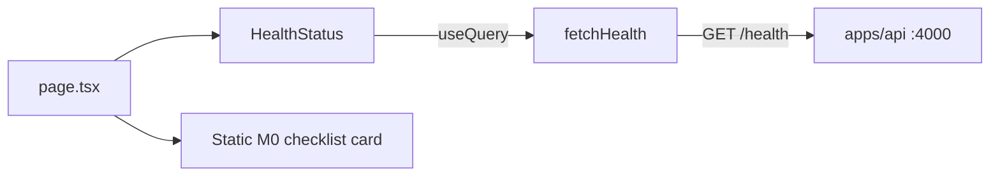

# SignalForge Frontend UI Audit

**Phase:** 1 — Audit only (no UI implementation)  
**Date:** August 2026  
**Scope:** `apps/web` — Next.js frontend  
**Related:** [Architecture](architecture.md) · [Product PRD](product/AI_Outbound_Sales_OS_PRD_v1.1.pdf)

---

## Executive summary

The SignalForge frontend is a **thin M0 foundation shell**, not a production SaaS product UI. It ships one route (`/`), two shadcn primitives (Button, Card), and one live API integration (`GET /health`). There is no application shell, navigation, auth, or feature pages.

**Implication for redesign:** Visual and structural work is largely **greenfield**. Preserve infrastructure patterns (App Router, TanStack Query, `fetchHealth`, `cn()`, shadcn conventions). Do **not** replace the working health check with mock data.

| Metric | Current state |
|--------|---------------|
| Routes | 1 (`/`) |
| Source files under `src/` | 9 |
| shadcn components installed | 2 |
| Live API integrations | 1 (`/health`) |
| Theme | Light only |
| Product pages | 0 |

---

## 1. Current architecture

### Stack overview

| Layer | Technology | Location / notes |
|-------|------------|------------------|
| Framework | Next.js 15 (App Router) | `apps/web/next.config.ts` — minimal (`reactStrictMode`) |
| Language | TypeScript (strict, via shared config) | `apps/web/tsconfig.json` |
| Styling | Tailwind CSS v4 (CSS-first) | `src/app/globals.css` — no `tailwind.config` file |
| UI primitives | shadcn/ui (partial) | `components.json` — style `new-york`, base `slate` |
| Icons | lucide-react | Installed but **unused** in source |
| Data fetching | TanStack Query v5 | `src/components/providers.tsx` |
| Forms | — | Not installed (no react-hook-form / zod in web app) |
| Charts | — | Not installed |
| Auth | — | No middleware, session provider, or protected routes |
| Shared UI package | — | All UI lives in `apps/web` only |

### Application structure

```
apps/web/
├── src/
│   ├── app/
│   │   ├── globals.css      # Design tokens (minimal)
│   │   ├── layout.tsx       # Root layout + Inter font
│   │   └── page.tsx         # Home (only page)
│   ├── components/
│   │   ├── providers.tsx    # QueryClientProvider
│   │   ├── health-status.tsx
│   │   └── ui/
│   │       ├── button.tsx
│   │       └── card.tsx
│   └── lib/
│       ├── api.ts           # fetchHealth()
│       └── utils.ts         # cn()
├── components.json          # shadcn config
├── postcss.config.mjs
└── package.json
```

### Backend boundary (preserve)

- **`src/lib/api.ts`** — `fetchHealth()` calls `GET ${NEXT_PUBLIC_API_URL}/health` with `cache: 'no-store'`.
- **`src/components/health-status.tsx`** — React Query hook with 30s refetch, manual refresh, loading/error/success UI.
- The Fastify API (`apps/api`) exposes health routes only. No product endpoints exist yet. Future UI should **extend** this client pattern, not remove working integrations.

### Data flow (current)



---

## 2. Current pages

### Implemented routes

| Route | File | Description | Product-ready? |
|-------|------|-------------|----------------|
| `/` | `src/app/page.tsx` | Hero, tagline, M0.01 copy, health card, checklist card | No — dev foundation landing |

### Framework defaults (not customized)

- Next.js `_not-found` — no custom `not-found.tsx`
- No `loading.tsx` or `error.tsx` at any segment

### Missing routes (product spec)

**Overview**

- Dashboard / home analytics

**Workspace**

- Leads, Companies, Lists, ICP

**Outbound**

- Campaigns, Sequences, Mailboxes, Warmup, Inbox

**Intelligence**

- Lead Discovery, AI Research, Personalization, Lead Scoring

**Analytics**

- Overview, Campaign Analytics, Deliverability, Reports

**Settings**

- Workspace, Team, Integrations, Domains, Billing

**Auth**

- Login, signup, onboarding (planned M1)

### Missing routing infrastructure

- Route groups: `(app)`, `(auth)`, `(marketing)`
- Middleware for auth / workspace isolation
- Breadcrumb / page context system
- Layout nesting for sidebar + header shell

---

## 3. Current components

### Feature components

| Component | Path | Role | Recommendation |
|-----------|------|------|----------------|
| `Providers` | `components/providers.tsx` | Wraps app in `QueryClientProvider` | **Reuse** — extend with Toaster, theme, command palette in Phase 2–3 |
| `HealthStatus` | `components/health-status.tsx` | Polls API health, refresh button | **Refactor** — keep query pattern; add Skeleton, Alert, Badge; move to settings/monitoring context |

### shadcn UI primitives

| Component | Path | Completeness |
|-----------|------|--------------|
| `Button` | `components/ui/button.tsx` | Partial — variants: `default`, `outline`; sizes: `default`, `sm` only |
| `Card` | `components/ui/card.tsx` | Partial — Header, Title, Description, Content; no Footer |

### Not installed (required by product / design spec)

Alert, Avatar, Badge, Breadcrumb, Command, Combobox, Date picker, Dialog, Dropdown menu, Input, Pagination, Progress, Select, Separator, Sheet, Sidebar, Skeleton, Table, Tabs, Toast, Tooltip

### Hooks / utilities

| Asset | Path | Status |
|-------|------|--------|
| `cn()` | `lib/utils.ts` | Implemented — clsx + tailwind-merge |
| Custom hooks | — | None (`useLeads`, etc. do not exist) |
| API client abstraction | `lib/api.ts` | Single function only |

---

## 4. Current styling system

**Primary file:** `apps/web/src/app/globals.css`

### Design tokens (Tailwind v4 `@theme inline`)

| Token | Current value | Notes |
|-------|---------------|-------|
| `--color-background` | `oklch(0.985 0.002 247)` | Near-white — **light mode** |
| `--color-foreground` | `oklch(0.2 0.02 255)` | Dark text |
| `--color-card` | `oklch(1 0 0)` | White cards |
| `--color-primary` | `oklch(0.45 0.14 255)` | Blue accent (reasonable base for royal blue) |
| `--color-muted` | `oklch(0.95 0.01 255)` | Light gray |
| `--color-muted-foreground` | `oklch(0.45 0.02 255)` | Mid gray text |
| `--color-border` | `oklch(0.9 0.01 255)` | Light border |
| `--radius-lg` | `0.75rem` | Only one radius token defined |

### Missing tokens (vs target design system)

- `--destructive`, `--accent`, `--ring`, `--popover`, `--sidebar-*`
- Chart colors (`--chart-1` …)
- Shadow / elevation scale
- Dark theme variables
- Semantic success / warning / info colors

### Typography

- **Font:** Inter via `next/font/google` in `layout.tsx` — aligns with spec; **reuse**.
- **Hierarchy:** Ad hoc on home page (`text-4xl` hero, `text-sm` labels). No shared `PageHeader`, `SectionTitle`, or type scale document.

### Spacing

- Page uses `px-6 py-16`, `gap-8`, `space-y-4` — reasonable but **undocumented**.
- No enforced 4px/8px spacing system in code or docs.

### Target design direction (from product brief)

| Target | Spec value | Current gap |
|--------|------------|-------------|
| Primary background | `#09090B` | Light background |
| Secondary background | `#0F1117` | Not defined |
| Card | `#111318` | White |
| Elevated card | `#151821` | Not defined |
| Primary text | `#F8FAFC` | Dark on light |
| Accent | Royal blue `#2563EB` | Partial via primary token on wrong base |

---

## 5. Current shadcn setup

**Config:** `apps/web/components.json`

| Setting | Value |
|---------|-------|
| Style | `new-york` |
| RSC | `true` |
| CSS variables | `true` |
| Base color | `slate` |
| CSS entry | `src/app/globals.css` |
| Aliases | `@/components`, `@/lib/utils`, `@/components/ui` |

**Installed:** 2 components (Button, Card)  
**Expected for SaaS product:** ~20–25 base components + layout blocks (Sidebar, Command)

**Customization depth:** Low. Components reference semantic tokens, but the token set is incomplete. Button/Card are simplified forks of standard shadcn implementations.

---

## 6. Problems

### Visual / brand

1. **Wrong visual mode** — Light dev landing contradicts dark premium B2B SaaS target (Linear, Vercel, Stripe quality bar).
2. **No brand identity** — No logo, icon mark, or favicon. Only uppercase "SignalForge" text label.
3. **No glass / elevation language** — Flat white cards; no restrained depth or sidebar treatment.
4. **M0 copy visible to users** — "M0.01 Complete" and infrastructure checklist read as internal engineering status, not product value.

### Structure

5. **No application shell** — No sidebar, header, workspace selector, or user menu.
6. **No information architecture** — Single page; no product areas (Leads, Campaigns, etc.).
7. **No dashboard hierarchy** — No primary vs secondary metrics, charts, or intelligence cards.

### Technical design

8. **Incomplete design tokens** — Cannot build consistent states (destructive, focus ring, sidebar) without expansion.
9. **No visualization layer** — Analytics, deliverability, and warmup dashboards require a chart library (recharts recommended; no animation libs per spec).
10. **Non-semantic error styling** — `HealthStatus` uses hardcoded `text-red-600` instead of `--destructive`.

---

## 7. Inconsistencies

| Area | Current behavior | Expected (spec) |
|------|------------------|-----------------|
| Theme | Light background, dark text | Dark foundation, light text |
| Primary accent | Blue on white | Royal blue accent on dark surfaces |
| Button API | 2 variants, 2 sizes | Full shadcn variant set (ghost, destructive, link, icon) |
| Card API | No Footer | Card + Footer for actions |
| Error states | Raw Tailwind red | Semantic destructive token + Alert component |
| Icons | Package installed, zero usage | Consistent 16px / 20px nav and action icons |
| Copy tone | Engineering milestone language | B2B outbound sales microcopy |
| ESLint | Next.js plugin not in ESLint config | Build warning during `next build` |
| Loading UX | Plain text string | Skeleton components matching layout |

---

## 8. UX issues

### Wayfinding

- User cannot answer **"Where am I?"** — no nav, breadcrumbs, or page titles beyond the hero.
- No workspace context or multi-tenant UI (planned M1).

### Actions

- No primary product CTAs: Create Campaign, Find Prospects, Connect Mailbox, Review Replies.
- Only action on page: "Refresh status" on health card.

### States

| State | Current | Gap |
|-------|---------|-----|
| Empty | N/A (no lists) | Need premium empty states before feature pages ship |
| Loading | Text: "Checking API health..." | Need Skeleton layouts per page type |
| Error | Single line + red text | Need Alert + Try Again + Contact Support pattern |
| Success | Inline key-value pairs | Need status badges and metric formatting |

### Power-user patterns

- No command palette (Cmd+K)
- No global search
- No keyboard shortcut documentation
- No notification center

### Accessibility gaps

- Focus visible on Button only (`focus-visible:ring-2`)
- No skip-to-content link
- No landmark regions (`nav`, `main` with labels) in app shell — home `main` exists but minimal
- Health status region lacks `aria-live` for polling updates
- No tested contrast against WCAG for dark theme (not yet implemented)

---

## 9. Responsive issues

| Viewport | Current behavior | Gap |
|----------|------------------|-----|
| 1440px+ | Centered `max-w-5xl` column | App shell should use full width with sidebar |
| 1280px / 1024px | Two-column grid at `md:` | No collapsible sidebar |
| Tablet | Hero and cards stack | No drawer navigation |
| Mobile | Readable hero | No mobile nav, no bottom-safe CTAs |
| Data tables | N/A | Leads/Campaigns will need horizontal scroll or column priority strategy |

**Touch targets:** Button heights (`h-9`, `h-10`) are acceptable; future dense tables and icon buttons need 44px minimum audit.

---

## 10. Recommended redesign plan

Phases align with the product UI specification. **Do not start Phase 2 until this audit is approved.**

| Phase | Focus | Deliverables |
|-------|-------|--------------|
| **1** | Audit | This document |
| **2** | Design system | Dark tokens, full shadcn set, `docs/design-system.md`, reusable primitives |
| **3** | App shell | Sidebar, header, workspace switcher, command menu, user menu |
| **4** | Dashboard | Greeting, metric cards, charts, AI insights, secondary sections |
| **5** | Leads | List table, filters, lead detail, ICP score UI |
| **6** | Campaigns | Campaign list, detail, sequence builder, email composer layout |
| **7** | Mailboxes | Mailbox health, warmup, deliverability dashboards |
| **8** | Inbox | Three-pane reply management |
| **9** | Discovery / ICP / AI | Search builder, intelligence panels |
| **10** | Analytics / Settings | BI-style analytics, two-column settings |

### Routing strategy

```
apps/web/src/app/
├── (marketing)/          # Optional public landing
├── (auth)/               # login, signup (M1)
└── (app)/                # Authenticated product shell
    ├── layout.tsx        # Sidebar + Header
    ├── page.tsx          # Dashboard (Overview)
    ├── leads/
    ├── campaigns/
    ├── mailboxes/
    ├── inbox/
    ├── discovery/
    ├── analytics/
    └── settings/
```

When auth lands (M1), `/` may redirect to dashboard or remain marketing.

### Data strategy

- Extend `lib/api.ts` with typed fetch helpers as backend milestones ship.
- Use **empty states and skeletons** when APIs are unavailable.
- **Never** replace live `fetchHealth` with fake “connected” data.
- Demo/placeholder metrics on dashboard may use clearly labeled static data until M10 analytics API exists.

### Constraints (from product brief)

- No Framer Motion, GSAP, or animation libraries
- CSS transitions and Tailwind only
- Royal blue accent — not full-blue UI
- Do not copy Apollo, Instantly, Smartlead interfaces

---

## 11. Components to reuse

| Asset | Path | Why reuse |
|-------|------|-----------|
| `cn()` utility | `src/lib/utils.ts` | Standard shadcn class merging |
| `Providers` | `src/components/providers.tsx` | QueryClient already configured |
| `fetchHealth` | `src/lib/api.ts` | Only live API integration |
| `HealthStatus` query pattern | `src/components/health-status.tsx` | Reference for React Query + refresh |
| Inter font setup | `src/app/layout.tsx` | Matches typography spec |
| `components.json` | `components.json` | shadcn CLI entry point |
| Button / Card structure | `src/components/ui/*` | Extend variants; avoid rewrite from scratch |
| TanStack Query | `package.json` | Correct data layer for SaaS views |

---

## 12. Components to refactor

| Component / file | Required changes |
|------------------|------------------|
| `globals.css` | Migrate to dark premium token set; add full semantic palette, radius scale, shadows, chart colors |
| `layout.tsx` | Dark class on `html`, favicon, optional theme provider |
| `page.tsx` | Remove M0 dev copy; product entry or redirect into app shell |
| `ui/button.tsx` | Add ghost, destructive, secondary, link variants; icon size; `--ring` focus |
| `ui/card.tsx` | Add Footer; elevated variant; align padding to 8px grid |
| `health-status.tsx` | Skeleton loading, Alert error, Badge for status, `aria-live` |
| `eslint.config.js` | Integrate Next.js plugin to clear build warning |

---

## 13. Components to create

### Phase 2–3 (foundation)

| Component | Purpose |
|-----------|---------|
| `BrandMark` / Logo | Full + icon-only; favicon |
| `AppSidebar` | Primary navigation with section labels |
| `AppHeader` | Breadcrumb, search, notifications |
| `WorkspaceSwitcher` | Multi-tenant context (UI shell; wire M1) |
| `UserMenu` | Profile, settings, sign out |
| `CommandMenu` | Cmd+K palette (cmdk + shadcn Command) |
| `PageHeader` | Title, subtitle, primary/secondary actions |
| `MetricCard` | Dashboard KPI with delta |
| `StatusBadge` | Campaign/mailbox/lead statuses |
| `ScoreIndicator` | ICP circular or compact score |
| `EmptyState` | Icon, message, CTA |
| `Skeleton` layouts | Page-type-specific loading |
| shadcn primitives | Input, Select, Table, Dialog, Sheet, Tabs, Tooltip, Toast, Alert, etc. |

### Phase 4+ (features)

| Component | Purpose |
|-----------|---------|
| `DataTable` + filters + pagination | Leads, campaigns, mailboxes |
| `ChartCard` + recharts wrappers | Activity, reply rate, performance |
| `SequenceStepCard` | Campaign sequence builder |
| `EmailComposer` | Three-column composer layout |
| `InboxLayout` | Folder list + thread list + detail |
| `MailboxHealthCard` | Health score + metrics |
| `DeliverabilityPanel` | SPF/DKIM/DMARC status |
| `AIInsightCard` | Intelligence summaries |
| `LeadIntelligencePanel` | ICP match reasons, opportunity |
| `SettingsLayout` | Left nav + content panel |

---

## Appendix A — File inventory

### Source files (`apps/web/src/`)

| File | Lines (approx.) | Type |
|------|-----------------|------|
| `app/globals.css` | 25 | Styles / tokens |
| `app/layout.tsx` | 21 | Root layout |
| `app/page.tsx` | 41 | Page |
| `components/providers.tsx` | 11 | Provider |
| `components/health-status.tsx` | 51 | Feature |
| `components/ui/button.tsx` | 41 | UI primitive |
| `components/ui/card.tsx` | 28 | UI primitive |
| `lib/api.ts` | 18 | API client |
| `lib/utils.ts` | 6 | Utility |

### Config files

| File | Purpose |
|------|---------|
| `components.json` | shadcn configuration |
| `next.config.ts` | Next.js config |
| `postcss.config.mjs` | Tailwind PostCSS |
| `tsconfig.json` | TypeScript paths `@/*` |
| `eslint.config.js` | ESLint flat config |
| `.env.example` | `NEXT_PUBLIC_API_URL` |

---

## Appendix B — Current vs target

| Dimension | Current (M0) | Target (premium SaaS) |
|-----------|--------------|------------------------|
| Routes | 1 | 25+ organized routes |
| Theme | Light | Dark navy foundation |
| Accent | Blue on white | Royal blue `#2563EB` on dark |
| Navigation | None | Sidebar + header |
| Dashboard | None | Metrics, charts, AI insights |
| Tables | None | Polished data tables |
| Empty / loading / error | Minimal | Full state system |
| Brand | Text label | Logo, favicon, identity |
| API integration | Health only | Full product API (incremental) |
| Animation | None | CSS-only micro-interactions |

---

## Appendix C — Backend readiness map

UI phases depend on API milestones ([architecture.md](architecture.md)):

| UI phase | Backend milestone | Notes |
|----------|-------------------|-------|
| Shell + design system | M0 (done) | Can proceed without API |
| Auth UI | M1 | Sessions, workspace |
| Leads UI | M2 | CRUD, import |
| Mailboxes UI | M3 | SMTP/IMAP connect |
| Campaigns UI | M4 | Builder, sequences |
| Inbox UI | M6 | IMAP sync, replies |
| Warmup / deliverability UI | M7–M8 | Health metrics |
| AI panels | M9 | Mock provider exists server-side |
| Analytics UI | M10 | Event aggregation |

---

## Appendix D — Risk notes

1. **Greenfield UI** — Almost no product UI to regress; preserve `fetchHealth` only.
2. **Placeholder data** — Dashboard mock metrics must be clearly non-production until APIs exist.
3. **Chart dependency** — Add `recharts` in Phase 4; explicitly exclude Framer Motion / GSAP.
4. **Shared UI package** — Consider `packages/ui` if admin or docs need components; not required for Phase 2.
5. **No backend changes in UI phases** — UI work consumes API contracts; coordinate with milestone delivery.

---

## Next step

**Phase 2:** Implement SignalForge design system (dark tokens, shadcn components, documentation).  
**Do not proceed automatically** — confirm audit approval first.
